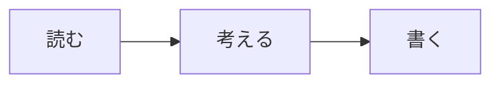

# 読書ノート

考えたことを、少しずつ言葉に。
Markdownなら、文章と図をひとつのノートにまとめられます。

## 今日のメモ

大切なのは、読み終えたページ数よりも、**心に残った一文**。
気になった言葉を書き留め、あとから自分の考えを添えていきます。

> 書くことは、考えを整理する時間。

## 考えを図にする

## 次にやること

- [x] 心に残った文章をメモする
- [x] 関係を図にして整理する
- [ ] 自分の言葉で短くまとめる

## まとめて共有

| 形式 | 使いどころ |
| --- | --- |
| Markdown | あとから編集を続ける |
| HTML | 画像や図もひとつのファイルに |
| PDF | レイアウトを保って共有する |

文書はこのデバイスで編集し、必要なときに保存します。
